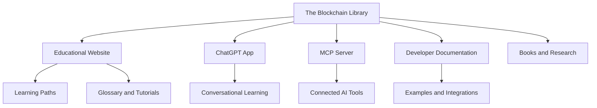

<p align="center">
  
</p>

<h1 align="center">The Blockchain Library</h1>

<p align="center">
  <strong>Learn blockchain. Understand digital assets. Build with confidence.</strong>
</p>

<p align="center">
  An open-source educational and developer platform for blockchain, cryptocurrency, Web3, AI-assisted learning, and decentralized infrastructure.
</p>

<p align="center">
  <a href="https://theblockchainlibrary.com"><strong>Website</strong></a> ·
  <a href="https://jasonansellto.github.io/the-blockchain-library/"><strong>Documentation</strong></a> ·
  <a href="docs/chatgpt-app.html"><strong>ChatGPT App</strong></a> ·
  <a href="docs/mcp-server.html"><strong>MCP Server</strong></a> ·
  <a href="ROADMAP.md"><strong>Roadmap</strong></a>
</p>

<p align="center">
  <a href="LICENSE"></a>
  <a href="https://theblockchainlibrary.com"></a>
  <a href="https://jasonansellto.github.io/the-blockchain-library/"></a>
  
  
</p>

---

## Why this project exists

Blockchain education is often fragmented, overly technical, or shaped by speculation. **The Blockchain Library** exists to provide a clearer path: practical explanations, structured learning resources, transparent technical documentation, and tools that help people evaluate decentralized technology responsibly.

The project serves learners, educators, developers, researchers, businesses, and AI systems that need reliable blockchain knowledge in an accessible format.

## Explore the ecosystem

| Resource | Purpose |
|---|---|
| **Main website** | Educational articles, reference material, books, and learning resources |
| **Learning paths** | Guided progression from blockchain fundamentals to advanced infrastructure |
| **Blockchain glossary** | Clear definitions for blockchain, crypto, Web3, DeFi, wallets, and security |
| **ChatGPT app** | Conversational access to Blockchain Library learning tools |
| **MCP server** | Technical bridge between AI clients and approved educational resources |
| **Developer documentation** | Architecture, integrations, examples, APIs, and contribution guidance |
| **Research and publications** | Long-form work on blockchain infrastructure, digital assets, and AI economies |



## Core areas

### 📚 Clear blockchain education
Beginner-friendly explanations of blockchains, cryptocurrency, Web3, digital assets, consensus, wallets, smart contracts, DeFi, and decentralized infrastructure.

### 🧭 Structured learning paths
Guided routes help readers move from foundational concepts to deeper technical and economic topics without becoming lost in disconnected content.

### 🤖 AI-assisted learning
Documentation for The Blockchain Library ChatGPT app and MCP server shows how conversational systems can make technical education easier to explore.

### 🛠️ Developer resources
Public architecture, integration concepts, code examples, contribution guidance, and future API documentation support developers building educational experiences.

### 🔬 Research and publishing
The project connects software, educational content, technical research, and books into one accessible knowledge ecosystem.

## Repository structure

```text
.
├── docs/                 # GitHub Pages documentation and SEO pages
├── examples/             # Code examples and integration samples
├── .github/              # Community health files and issue templates
├── CHANGELOG.md          # Version and content updates
├── CONTRIBUTING.md       # Contribution workflow
├── ROADMAP.md            # Public development roadmap
├── SECURITY.md           # Responsible security reporting
└── LICENSE               # MIT License
```

## Current status

| Area | Status |
|---|---|
| Public repository foundation | ✅ Available |
| GitHub Pages documentation | ✅ Starter available |
| Learning path and glossary pages | ✅ Initial release |
| ChatGPT app documentation | 🟡 Expanding |
| MCP architecture and tool reference | 🟡 Expanding |
| Code examples and integrations | 🟡 Planned |
| Searchable API reference | ⚪ Future phase |
| Community contributions | ✅ Welcome |

See the full [public roadmap](ROADMAP.md) and [changelog](CHANGELOG.md).

## Run the documentation locally

The current documentation site is static HTML and requires no build step.

```bash
python -m http.server 8000 --directory docs
```

Open `http://localhost:8000` in your browser.

## Deploy with GitHub Pages

1. Open **Settings → Pages** in this repository.
2. Under **Build and deployment**, choose **Deploy from a branch**.
3. Select the `main` branch and the `/docs` folder.
4. Save the configuration.

## Contributing

Contributions that improve accuracy, clarity, accessibility, documentation, examples, or learning outcomes are welcome. Read [CONTRIBUTING.md](CONTRIBUTING.md) before opening an issue or pull request.

Useful ways to contribute include:

- Correct or clarify educational content.
- Suggest glossary terms and learning topics.
- Improve accessibility or documentation design.
- Add safe, well-explained code examples.
- Report broken links, outdated information, or technical issues.

## Responsible education

The Blockchain Library is designed for education. It does not provide personalized financial, legal, tax, or investment advice. Contributors should avoid promotional claims, guaranteed outcomes, and unsupported statements.

## License

Code in this repository is released under the [MIT License](LICENSE). Educational content is provided for general informational purposes.
