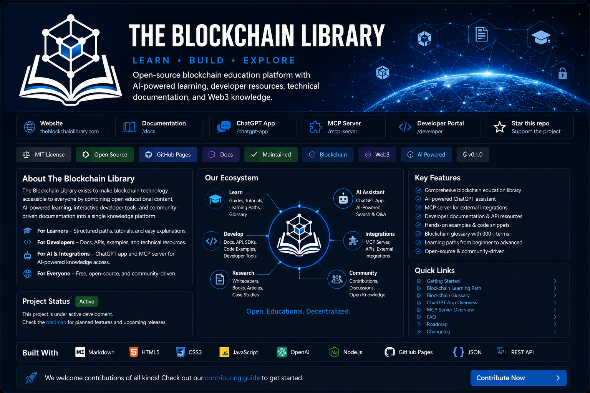

# The Blockchain Library

[](https://theblockchainlibrary.com)

**Learn blockchain. Build the future.**

The Blockchain Library is an open-source knowledge platform for blockchain education, AI-assisted learning, developer resources, technical documentation, research, and structured reference content.

[Website](https://theblockchainlibrary.com) · [Documentation](https://theblockchainlibrary.com) · [GitHub](https://github.com/jasonansellto/the-blockchain-library)

## Knowledge Engine

Version 0.4.0 introduces a structured knowledge layer so topics, definitions, relationships, learning paths, and resources can be reused across documentation, search, AI tools, APIs, quizzes, and future applications.

```text
data/knowledge/
├── topics.json
├── glossary.json
├── relationships.json
├── learning-paths.json
└── resources.json
```

The human-readable Mintlify documentation remains the canonical reading experience. Structured data provides stable IDs, relationships, and metadata that software can reuse.

## What this repository contains

- Structured blockchain learning paths
- Connected topic hubs and knowledge graph
- Machine-readable Knowledge Engine datasets
- Developer documentation and architecture notes
- ChatGPT App and MCP Server documentation
- API planning and reference material
- Blockchain glossary content
- Research and publishing documentation
- Public roadmap, changelog, security, and contribution guidelines

## Validate the Knowledge Engine

```bash
npm run validate:knowledge
```

GitHub Actions runs the same validation when structured knowledge files change.

## Local documentation preview

```bash
npm i -g mint
mint dev
```

## Repository highlights

- `docs.json` — Mintlify configuration and navigation
- `index.mdx` — documentation homepage
- `data/knowledge/` — reusable structured knowledge objects
- `schemas/` — JSON schemas for canonical object types
- `knowledge-engine/` — Knowledge Engine documentation
- `topics/` — connected topic hubs
- `knowledge-graph/` — relationship architecture
- `learn/` — educational learning paths
- `developers/` — technical documentation
- `chatgpt-app/` — ChatGPT integration documentation
- `mcp-server/` — MCP documentation
- `api/` — API reference foundation
- `glossary/` — reference terminology
- `research/` — research and publishing
- `project/` — roadmap, changelog, FAQ, and contributions

## Contributing

Contributions that improve accuracy, clarity, accessibility, examples, documentation, structured data, or learning content are welcome. See `CONTRIBUTING.md` and `/knowledge-engine/contributing`.

## License

Code in this repository is licensed under the MIT License unless otherwise noted. Educational and publishing content may have separate rights where explicitly identified.
