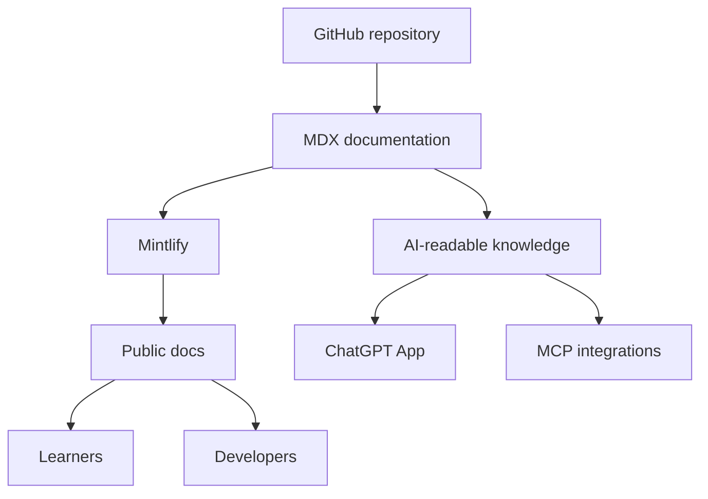

## High-level model

## Source of truth

Git history provides reviewability, attribution, versioning, and rollback. Mintlify provides navigation, search, rendering, deployment, and AI-oriented documentation surfaces.

## Separation of concerns

The documentation repository should contain public knowledge and technical reference material. Private operational data, secrets, credentials, and unpublished security-sensitive information should not be committed.
