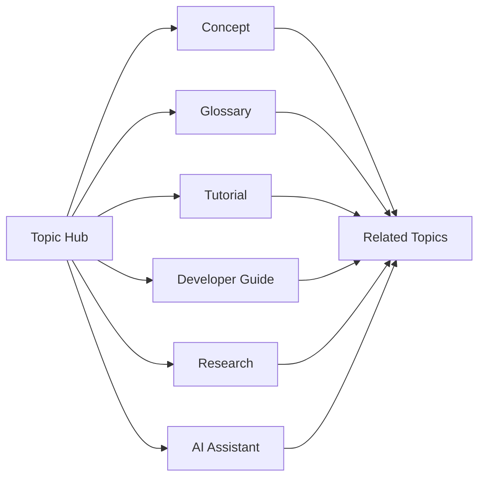

  
  <h1 style={{fontSize: "3rem", marginTop: "1rem", marginBottom: ".5rem"}}>Learn blockchain. Build the future.</h1>
  

    An open-source knowledge platform connecting blockchain education, developer documentation,
    AI-assisted learning, research, and structured reference material.
  

<CardGroup cols={3}>
  <Card title="Start learning" icon="graduation-cap" href="/learn/learning-path">
    Follow a structured path from blockchain fundamentals to advanced decentralized systems.
  </Card>
  <Card title="Explore topic hubs" icon="grid-2x2" href="/topics/overview">
    Enter through connected hubs for blockchain, wallets, DeFi, Web3, infrastructure, AI, and more.
  </Card>
  <Card title="Developer portal" icon="code" href="/developers/overview">
    Explore architecture, integrations, examples, APIs, MCP, and technical documentation.
  </Card>
</CardGroup>

## Explore by topic

<CardGroup cols={3}>
  <Card title="Blockchain" icon="cubes" href="/topics/blockchain">Blocks, transactions, consensus, networks, nodes, finality, and distributed state.</Card>
  <Card title="Cryptocurrency" icon="coins" href="/topics/cryptocurrency">Digital assets, token models, transactions, custody, economics, and market structure.</Card>
  <Card title="Wallets & Security" icon="shield-check" href="/topics/wallets-security">Keys, seed phrases, signing, permissions, phishing, custody, and transaction safety.</Card>
  <Card title="Smart Contracts" icon="file-code-2" href="/topics/smart-contracts">Programmable execution, contract architecture, permissions, applications, and risk.</Card>
  <Card title="DeFi" icon="landmark" href="/topics/defi">Exchanges, liquidity, lending, stablecoins, collateral, risk, and programmable finance.</Card>
  <Card title="Web3" icon="globe-2" href="/topics/web3">Ownership, decentralized applications, open protocols, identity, and digital coordination.</Card>
  <Card title="Infrastructure" icon="server" href="/topics/infrastructure">Nodes, RPC, validators, execution, data availability, interoperability, and operations.</Card>
  <Card title="Enterprise Blockchain" icon="building-2" href="/topics/enterprise-blockchain">Business integration, predictability, governance, privacy, and deployment models.</Card>
  <Card title="AI + Blockchain" icon="brain-circuit" href="/topics/ai-blockchain">AI agents, programmable payments, machine identity, autonomous systems, and verifiable infrastructure.</Card>
</CardGroup>

## One knowledge system, multiple ways to explore

The Blockchain Library is designed around connected knowledge rather than isolated pages.

<CardGroup cols={2}>
  <Card title="Explore the knowledge graph" icon="share-2" href="/knowledge-graph/overview">
    See how concepts, learning paths, glossary entries, technical references, and research connect.
  </Card>
  <Card title="Research & Publishing" icon="microscope" href="/research/overview">
    Move beyond introductory material into long-form analysis, research, and publications.
  </Card>
</CardGroup>

## Build with the library

<CardGroup cols={3}>
  <Card title="ChatGPT App" icon="message-square" href="/chatgpt-app/overview">Explore the conversational interface.</Card>
  <Card title="MCP Server" icon="plug" href="/mcp-server/overview">Review the AI integration model.</Card>
  <Card title="API Reference" icon="braces" href="/api/overview">Follow developer interfaces as they evolve.</Card>
</CardGroup>

<Note>
The goal is not to create more disconnected blockchain content. It is to create a structured public knowledge system where each resource helps readers discover what to learn next.
</Note>
