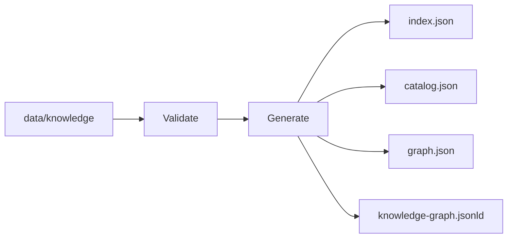

## Build pipeline



On Windows PowerShell:

```powershell
npm.cmd run build:knowledge
```

<Note>The generated JSON files are static data artifacts, not a claim that a production dynamic API is already live.</Note>
