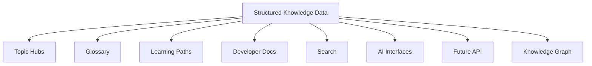

# One source of truth for many experiences

The Knowledge Engine is the structured data layer behind The Blockchain Library.

Instead of treating every page as an isolated document, the repository now defines reusable knowledge objects that can be connected to documentation, search, learning paths, AI tools, APIs, and future applications.



## Current data collections

<CardGroup cols={2}>
  <Card title="Topics" icon="grid-2x2" href="/knowledge-engine/topics">
    Canonical topic metadata, relationships, resource links, levels, and tags.
  </Card>
  <Card title="Glossary" icon="book-a" href="/knowledge-engine/glossary-data">
    Structured definitions designed for reference, search, AI retrieval, and future APIs.
  </Card>
  <Card title="Relationships" icon="share-2" href="/knowledge-engine/relationships">
    Explicit semantic edges between concepts and topics.
  </Card>
  <Card title="Learning paths" icon="route" href="/knowledge-engine/learning-paths">
    Ordered learning sequences that reuse canonical topic IDs.
  </Card>
</CardGroup>

## Repository source files

```text
data/knowledge/
├── topics.json
├── glossary.json
├── relationships.json
├── learning-paths.json
└── resources.json

schemas/
├── topic.schema.json
├── glossary-entry.schema.json
└── relationship.schema.json
```

## Why this matters

A structured data layer means the same canonical concept can eventually power:

- Human-readable topic pages
- Glossary definitions
- Related-content recommendations
- Search facets
- AI retrieval
- API responses
- Quizzes
- Study guides
- Learning-path progress
- Knowledge graph visualization
- Developer integrations

<Note>
Version 0.4.0 establishes the foundation. The current Mintlify pages remain the public reading experience while the structured layer becomes the reusable source for future automation.
</Note>
