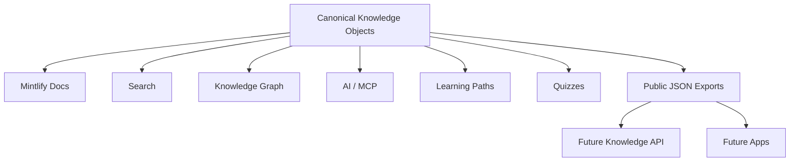

# From documentation to a knowledge platform

Version 1.0 formalizes The Blockchain Library as a knowledge platform.

<CardGroup cols={3}>
 <Card title="Topics" icon="grid-2x2">Canonical subjects and their relationships.</Card>
 <Card title="Glossary" icon="book-a">Compact definitions and terminology.</Card>
 <Card title="Books" icon="book-open">Long-form publications connected to topics.</Card>
 <Card title="Research" icon="microscope">Academic and technical research objects.</Card>
 <Card title="Tutorials" icon="route">Task-oriented learning resources.</Card>
 <Card title="AI & Quizzes" icon="brain-circuit">Reusable prompt and assessment objects.</Card>
</CardGroup>

The human-readable page remains the canonical explanation. Structured objects provide stable IDs, relationships, and reusable metadata.
