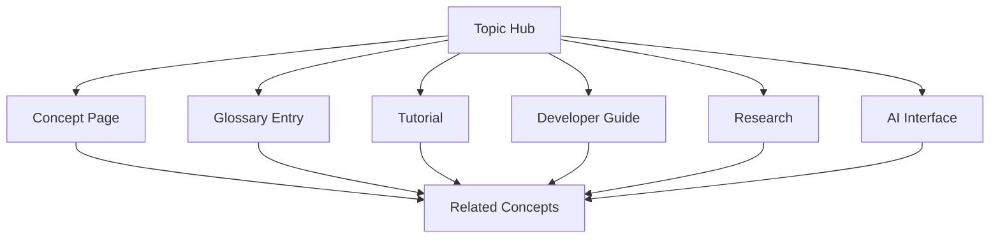

# Connected knowledge instead of isolated pages

The Blockchain Library is designed as a graph of related knowledge objects.

## Core knowledge objects

- Definition
- Beginner explanation
- Technical explanation
- Security considerations
- Tutorial
- Developer guide
- Code example
- API reference
- Research
- Publications
- Related glossary terms
- Neighboring topics
- AI-assisted question paths

## Current implementation

The first implementation uses topic hubs and explicit cross-links. Future phases can add structured metadata, machine-readable relationship files, and automated related-content generation.

<Card title="Explore topic hubs" href="/topics/overview" icon="grid-2x2">
Start navigating the first layer of the knowledge graph.
</Card>
