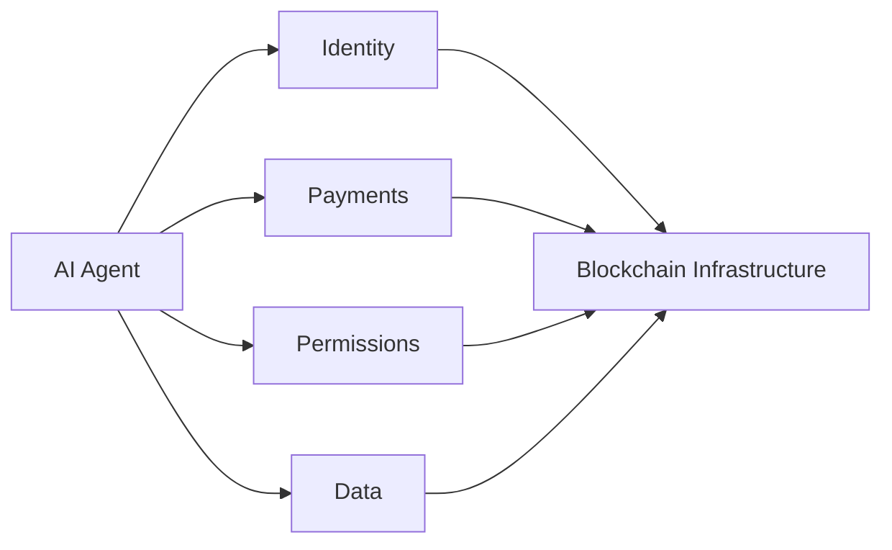

## Where the systems intersect

AI and blockchain can intersect when autonomous software needs identity, payments, assets, permissions, verifiable records, or programmable coordination.

<CardGroup cols={2}>
  <Card title="Developer resources" href="/developers/overview" icon="code" />
  <Card title="ChatGPT App" href="/chatgpt-app/overview" icon="message-square" />
  <Card title="MCP Server" href="/mcp-server/overview" icon="plug" />
  <Card title="Infrastructure" href="/topics/infrastructure" icon="server" />
</CardGroup>

The field is evolving quickly. Pages in this cluster should distinguish deployed systems from proposed architectures and emerging research.
