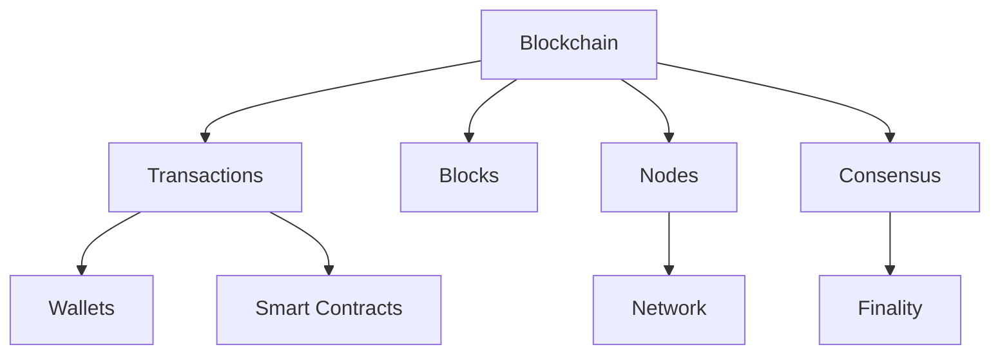

## Start here

Blockchain systems maintain a shared history of state changes across a network of participants.

<CardGroup cols={2}>
  <Card title="Blockchain basics" href="/learn/foundations/blockchain-basics" icon="book-open" />
  <Card title="Consensus" href="/learn/foundations/consensus" icon="network" />
  <Card title="Glossary" href="/glossary/overview" icon="book-a" />
  <Card title="Infrastructure" href="/topics/infrastructure" icon="server" />
</CardGroup>

