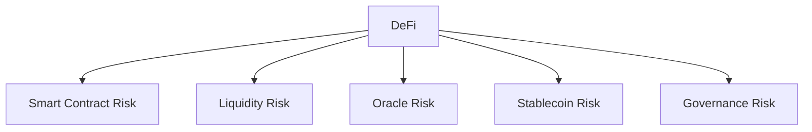

## Programmable finance

DeFi uses smart contracts and blockchain-based assets to implement financial functions such as exchange, lending, borrowing, collateral management, and liquidity provision.

<CardGroup cols={2}>
  <Card title="DeFi fundamentals" href="/learn/foundations/defi" icon="landmark" />
  <Card title="Smart contracts" href="/topics/smart-contracts" icon="file-code-2" />
  <Card title="Cryptocurrency" href="/topics/cryptocurrency" icon="coins" />
  <Card title="Wallet security" href="/topics/wallets-security" icon="shield-check" />
</CardGroup>

