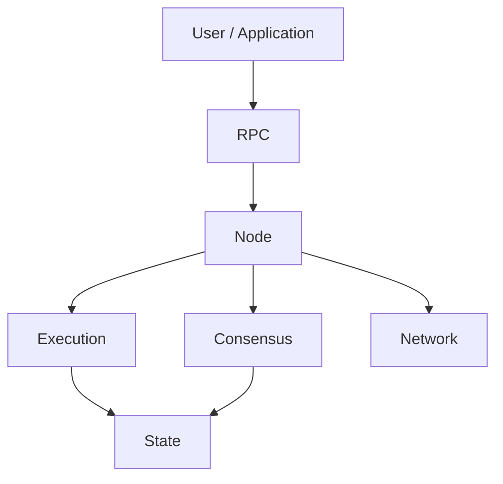

## The systems beneath the application

Blockchain infrastructure includes nodes, validators, RPC services, execution environments, indexing, storage, bridges, data availability, and interoperability systems.

<CardGroup cols={2}>
  <Card title="Blockchain fundamentals" href="/topics/blockchain" icon="cubes" />
  <Card title="Developer architecture" href="/developers/architecture" icon="code" />
  <Card title="Integrations" href="/developers/integrations" icon="plug" />
  <Card title="Enterprise blockchain" href="/topics/enterprise-blockchain" icon="building-2" />
</CardGroup>

