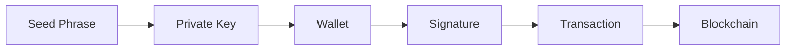

## Security begins before signing

Wallet security is primarily about protecting the credentials and approvals that authorize blockchain actions.

<CardGroup cols={2}>
  <Card title="Wallet fundamentals" href="/learn/foundations/wallets" icon="wallet" />
  <Card title="Wallet security" href="/learn/security/wallet-security" icon="shield-check" />
  <Card title="Scams & phishing" href="/learn/security/scams-and-phishing" icon="triangle-alert" />
  <Card title="Glossary" href="/glossary/overview" icon="book-a" />
</CardGroup>

<Warning>Never share private keys or seed phrases. Legitimate support teams do not need them.</Warning>
